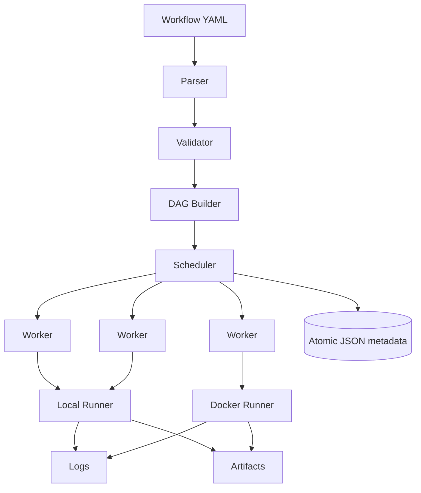
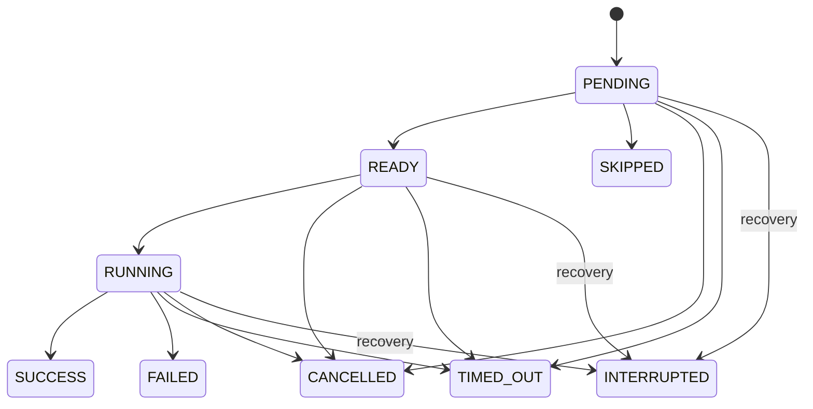

# CI/CD Engine

A self-hosted workflow execution engine built from scratch in Go.

This project implements its own YAML workflow model, DAG scheduler, worker pool,
execution state machine, retries, cancellation, artifact handling, and run history.
It is inspired by modern CI/CD systems but is not a replacement for GitHub Actions,
GitLab CI, Jenkins, or Buildkite. It does not implement their workflow formats.

## Features

- Strict, versioned YAML and validation before execution; deterministic DAG ordering.
- Bounded parallel workers with a global concurrency limit across active runs.
- Local process runner and Docker CLI runner with one container per job.
- Workflow, job, and step timeouts; cancellation and best-effort process tree cleanup.
- Step retries with capped exponential backoff and recorded attempts.
- Explicit conditions, failure propagation, and optional step failures.
- Source snapshots and isolated job workspaces, scoped environment variables.
- Environment-based secrets and streaming masking across write boundaries.
- Bounded JSONL logs, CLI following, and SSE live subscriptions.
- Size-limited tar.gz artifacts, SHA-256 checksums, downloads, retention, and traversal protection.
- Atomic filesystem metadata, exclusive engine ownership, restart interruption recovery.
- REST API, optional bearer authentication, health/readiness, and Prometheus text metrics.
- Unit, integration, stress, fuzz-seed, and scheduler benchmark tests.

Cache, matrix expansion, remote workers, automatic triggers, and a dashboard are
future work. Unknown YAML fields are rejected rather than silently ignored.

## Installation

Go 1.26.3 is the version used to build and test this repository. Docker is optional.
The race detector requires CGO and a supported C compiler (GCC on Windows).
No Node.js or database server is required.

```sh
go mod download
go build -o cicd ./cmd/cicd
./cicd --help
./cicd version
```

PowerShell users can build `go build -o cicd.exe ./cmd/cicd` and invoke `./cicd.exe`.

## Quick Start

```yaml
version: 1
name: My pipeline
jobs:
  test:
    steps:
      - command: [go, version]
  build:
    needs: [test]
    steps:
      - run: echo completed
```

```sh
./cicd validate examples/parallel.yaml
./cicd run examples/parallel.yaml --workers 3 --workspace .
./cicd runs list
./cicd runs show RUN_ID
./cicd logs RUN_ID --job test
```

Flags follow positional arguments. `--data` defaults to `data`. `--job build`
runs the selected job and all transitive dependencies. A failed, timed-out, or
cancelled foreground run returns a nonzero exit status. Ctrl+C cancels it.

## Architecture



See [architecture](docs/architecture.md), [scheduler](docs/scheduler.md),
[workflow format](docs/workflow-format.md), [security](docs/security.md),
[API](docs/api.md), [verification](docs/verification.md), and the
[68-point implementation report](docs/implementation-report.md).

## Workflow Lifecycle

Parse one YAML document, reject unknown fields, validate the entire workflow,
build the DAG, select ready roots, acquire global capacity, dispatch jobs, stream
step output, persist transitions, and propagate each completion to dependents.
Invalid workflows never create a run. Each run is a source snapshot; each job gets
its own copy. Jobs do not implicitly exchange generated files.

## DAG Scheduler

DFS colors detect cycles and report a concrete cycle path. A lexical min-heap
provides deterministic Kahn topological order and deterministic selection among
currently eligible jobs. Completion timing naturally affects concurrent dispatch.
The coordinator owns dependency counters and scheduler states. A fixed number of
workers returns completion messages through a bounded channel. The shared semaphore
bounds total execution across runs. Failed dependencies skip descendants;
independent jobs continue. There is no fail-fast mode or fairness guarantee.

## Job State Machine



Terminal states cannot return to RUNNING. Steps use the same lifecycle and record
start/end timestamps, exit code, final attempt count, and sanitized error. Retrying
keeps a step RUNNING; only its final outcome is terminal. Pending steps become
SKIPPED after job failure or CANCELLED/TIMED_OUT on parent cancellation.

## Step Execution and Local Runner

`command: [program, argument]` directly invokes a process without shell expansion.
`run:` executes shell syntax: `sh -c` on Unix, PowerShell without profiles on
Windows. Explicit `sh`, `bash`, `cmd`, `powershell`, and `pwsh` shells are supported.
The engine never builds shell commands from job IDs or secret values. Shell script
authors are responsible for command quoting, exit behavior, and checking failures
inside multi-command scripts. A shell's final exit code determines step success.

The local runner has the CI process's permissions. Only run trusted workflows on
trusted machines. It provides workspace organization, not a security sandbox.

## Docker Runner and Docker Jobs

```sh
./cicd run examples/docker.yaml --workspace .
```

One Linux container is created per job and mounted at `/workspace`; steps use
`docker exec` and share files. The runner uses labels for engine/run/job ownership,
drops capabilities, disables privilege escalation, and sets 1 GiB memory, two CPUs,
and a 256-process limit. It does not mount the Docker socket, use privileged mode,
or inherit the host environment. Only engine defaults and explicitly configured
environment keys enter the container. Its shell image must provide `sh` and `sleep`.

Cleanup removes the exact created container after success/failure/cancellation.
On restart, label-filtered cleanup is restricted to the owner hash of this data
directory. Startup skips Docker recovery if the daemon is unavailable; bring it
back and restart the engine to clean old containers. Docker is not a perfect
security sandbox. Docker execution and Compose have not been verified here because
the daemon was unavailable.

## Workspaces and Checkout

`--workspace PATH` selects local source; it never invokes GitHub or clones a remote.
Source is copied into `data/runs/ID/source`, then into `workspace/JOB`. `.git`,
`.cicd-data`, and the configured data directory are excluded. All snapshot symlinks
and special files are rejected. Snapshots are limited to 1 GiB/100,000 files per copy.
`uses: checkout` confirms the already prepared snapshot. No current-directory mode
is implemented. Separate jobs must not rely on shared writes or implicit artifacts.

## Environment and Secrets

Precedence: step > job > workflow > engine defaults > inherited local environment.
Engine variables: `CICD_RUN_ID`, `CICD_JOB_ID`, `CICD_STEP_ID` (one-based numeric string),
`CICD_WORKSPACE`, and `CICD_ATTEMPT`. Explicit YAML scopes may override them.
Docker receives no inherited host variables. Windows environment names should use
consistent case; use uppercase for engine variables and portable workflows.

Set `CICD_SECRET_TOKEN` in the engine environment, then reference it only in an
`env` value as `${{ secrets.TOKEN }}`. Missing referenced secrets fail the step.
Secret source variables are removed from the inherited step environment. The engine
does not load `.env` automatically. Up to 128 secret values of at most 4096 bytes
are accepted. Values are held in memory and excluded from run metadata.

Output is masked before JSON encoding, persistence, and live publication, including
matches split across writes. Each stream has a separate bounded masking buffer;
known values are replaced with `***`. Masking is best-effort: transformed values,
interleaved stdout/stderr fragments, artifacts, and user files are not protected.
Do not print secrets. See [security](docs/security.md).

## Retries

Only the failed step is retried. Default is one attempt; retry policy supports at
most ten. Delay is `min(initial_delay * multiplier^(attempt-1), max_delay)`.
Defaults: 100 ms initial, multiplier 2, 10 s maximum; configured delays cannot
exceed one minute. There is no jitter. Context cancellation interrupts backoff.
Retrying non-idempotent commands can duplicate side effects.

```sh
./cicd run examples/retry.yaml
# Unix: examples/retry-posix.yaml
```

## Timeouts and Cancellation

Workflow/job/step contexts inherit parent deadlines. A workflow without a timeout
has a one-hour maximum. A step timeout covers all its retries and backoff.
Unix cancellation kills the process group; Windows uses `taskkill /F /T` followed
by killing the direct process. Pipe waits are bounded. Process tree cleanup is
best-effort: escaped/daemonized descendants may survive. Docker cancellation removes
the job container. Disk copying/archiving is synchronous and cannot be forcibly
interrupted mid-syscall; large snapshots can delay shutdown.

```sh
./cicd run examples/timeout.yaml
# Unix: examples/timeout-posix.yaml
./cicd cancel RUN_ID --server http://127.0.0.1:8080
```

The cancel command targets daemon runs; use Ctrl+C for foreground runs. Shutdown
stops submissions, cancels active work, waits for workers and log flushing, and
releases metadata ownership. HTTP connections get a 15-second drain window after
engine work stops. There is no hard guarantee against an uninterruptible OS/filesystem.

## Failure Propagation and Conditions

`success()` (default) requires every dependency to succeed, or all previous
non-optional steps to succeed. `failure()` is true when a direct dependency failed,
timed out, or was interrupted; for steps it means an earlier non-optional failure.
`always()` permits cleanup after failure or skipped dependencies. `cancelled()`
checks cancelled direct dependencies; global cancellation prevents new jobs and
steps, even `always()`/`cancelled()` work. All dependencies must first be terminal.
No expressions, interpolation in shell text, or arbitrary evaluation is supported.

An optional failure (`continue_on_error: true`) is retained in step metadata but
does not fail the job or affect later default step conditions. Non-optional step
timeouts make the job TIMED_OUT. Failed and interrupted jobs make the run FAILED;
otherwise a timed-out job makes it TIMED_OUT. Parent cancellation takes precedence.
An all-skipped workflow is SUCCESS. Independent work continues after failure.

## Artifacts

```sh
./cicd run examples/artifacts.yaml
# Unix: examples/artifacts-posix.yaml
./cicd artifacts list RUN_ID
./cicd artifacts download RUN_ID application --output application.tar.gz
```

Artifacts are `.tar.gz` archives with persisted job/name/size/file-count/timestamp
and SHA-256 metadata. The checksum is verified by rereading the created archive.
Downloads stream files. Names must be unique across a workflow; duplicate names
are rejected. Default limits are 100 artifacts/run, 100 MiB uncompressed/artifact,
and 10,000 files/artifact. Upload failure fails the step unless optional.

Paths must be relative to the job workspace; absolute paths, traversal, drive/ADS
syntax, backslashes, symlink prefixes, symlink members, and special files are
rejected. Go `os.Root` constrains actual opens even during path changes. Only normal
permission bits are archived; ownership and setuid metadata are discarded.
Artifacts are not automatically downloaded by later jobs. Empty artifacts fail.

A daemon maintenance pass every minute removes artifacts from terminal runs whose
finish time exceeds `--artifact-retention` (default `168h`). Active writes are
excluded. Run metadata, snapshots, and logs are kept until manually archived or
removed while the engine is stopped. Retention needs the daemon running.

## Live Logs

Every JSONL record includes a per-run sequence, UTC timestamp, run, job, step,
stream, and masked message. Output chunks are bounded to about 16 KiB. Each run
persists at most about 64 MiB; additional output is consumed and discarded. Separate
stdout/stderr writers preserve stream identity. A trailing partial line flushes
when the step exits. Slow subscribers are disconnected after their 128-event
buffer fills and cannot block execution. SSE sends future events only; replay
comes from persisted logs. The REST logs endpoint returns at most the first 8 MiB.

```sh
./cicd logs RUN_ID --follow
curl -N http://127.0.0.1:8080/api/v1/runs/RUN_ID/logs/stream
```

## Run Persistence and Crash Recovery

Metadata uses schema-versioned atomic JSON snapshots, not SQLite. Files are synced
before rename-over. Windows readers share delete access so concurrent snapshots
can be replaced. Logs and archives are separate files. An OS file lock permits one
engine per data directory; history and logs can be read by other CLI processes.
Engine ownership is released automatically by the OS after a crash. Restart marks
nonterminal runs/jobs/steps INTERRUPTED. Shell processes are not resumed. Metadata
is durable against normal process interruption, with filesystem/power-loss limits;
no exactly-once execution is claimed.

## API and Metrics

```sh
./cicd serve --addr 127.0.0.1:8080 --workspace . --workers 4 --max-runs 8
curl -H 'Content-Type: application/yaml' --data-binary @examples/parallel.yaml http://127.0.0.1:8080/api/v1/runs
```

Optional authentication reads `CICD_API_TOKEN`; a non-loopback bind requires it.
The API is arbitrary-code execution access for its fixed source directory. Never
expose it directly to untrusted users or the public Internet. TLS, RBAC, tenant
isolation, and rate limiting are not implemented.

Endpoints: `/health`, `/ready`, `/metrics`; create/list/get runs; list jobs;
cancel; read/stream logs; list/download artifacts. See [API details](docs/api.md).
Health reports process availability. Readiness checks shutdown state and data
writability. Metrics expose run/job totals and active counts plus used/total worker
slots. Counters reset on restart; a Prometheus server is optional.

## Docker Compose

Set `CICD_API_TOKEN` and run `docker compose up --build`. The image runs as an
unprivileged user with the local runner and a read-only source bind. Its Alpine
shell is available, but Go/Node tools are not included in the final image. Nested
Docker execution is not configured; the Docker socket is never mounted. Compose
is an optional unverified deployment recipe, not a hosted CI integration.

## Testing

```sh
go mod tidy
gofmt -w cmd internal
go vet ./...
go test ./...
go test -race ./...
go build -o cicd ./cmd/cicd
```

Tests use temporary directories and helper subprocesses, with no dependency on
Git or external services. Docker-specific tests skip when the daemon is unavailable;
when available they require an already cached `alpine:3.21` image and Linux containers.
Ordinary symlink tests skip if Windows does not grant creation privileges; a
separate Windows junction escape test covers reparse-point traversal. See the actual
[verification record](docs/verification.md), including environment limitations.

## Benchmarking

```sh
./cicd benchmark scheduler --jobs 10000 --workers 32
go test ./internal/scheduler -run '^$' -bench BenchmarkScheduler -benchmem
go test ./internal/scheduler -run TestStress -count 1
```

These measure synthetic no-op scheduling, not shell or Docker throughput. The CLI
reports measured elapsed time/throughput and dispatch-to-observed-completion
P50/P95 latency. This latency includes worker dispatch and coordinator processing;
it is not a pure ready-queue delay. The Go benchmark also reports allocations.
No performance results are hardcoded into the benchmark.

## Project Structure

```text
cmd/cicd/             CLI, foreground runner, API daemon, benchmark command
internal/workflow/    typed schema, strict YAML, validation, conditions
internal/dag/         dependency edges, lexical heap, topological ordering
internal/scheduler/   state machine, bounded workers, dependency propagation
internal/runner/      local and Docker sessions, platform process cleanup
internal/engine/      run lifecycle, step execution, retries, environments
internal/logs/        streaming masker, JSONL sink, bounded subscriptions
internal/storage/     snapshots, atomic JSON, ownership, artifacts, retention
internal/api/         REST routes, auth, SSE, streaming downloads
examples/             runnable workflows and intentionally invalid inputs
docs/                 architecture, scheduler, workflow, API, security, verification
scripts/              repeatable verification commands
```

## External Dependencies

`gopkg.in/yaml.v3 v3.0.1` provides YAML decoding and duplicate-key detection. The
engine implements workflow semantics itself. `gopkg.in/check.v1` is only an
indirect checksum entry used by YAML's upstream tests. All other runtime code uses
the Go standard library. Docker integration uses the installed Docker CLI.

## What I Learned

This implementation demonstrates DAGs and DFS/Kahn algorithms, bounded worker
pools, single-owner concurrency, context propagation, OS process management,
retry/backoff, Docker lifecycle integration, streaming masking/logs, secure archive
creation, filesystem persistence, SSE, and CI/CD architecture.

## Security Model

CI workflows execute arbitrary code. Only run trusted workflows on trusted
machines. The local runner has host permissions, and Docker is not a perfect
sandbox. Secret masking cannot prevent deliberate exfiltration. Workspaces and
artifact path checks do not contain a malicious local process. See
[security](docs/security.md) for the boundaries and resource limits.

## Limitations

Educational/portfolio scale; a single node with a single engine owner; no platform
compatibility; no exactly-once execution, distributed workers, autoscaling,
Kubernetes executor, cache, matrix jobs, web dashboard, artifact download action,
full expression language, vault, or automatic Git/webhook triggers. No fair
scheduling guarantee across runs. Metadata updates rewrite a run snapshot, making
very large real workflows expensive. The scheduler-only benchmark excludes that
cost. Filesystem quotas, snapshot/log retention, and production operational hardening
remain the operator's responsibility. Docker and Unix process handling need
execution verification on their target platforms.

## Future Improvements

Workspace-relative cache; bounded matrix expansion; cross-job artifact downloads;
manual approvals; React DAG/log dashboard; distributed workers with explicit
at-least-once semantics; stronger Windows job-object containment; OIDC/RBAC;
S3 artifacts; encrypted secrets; OpenTelemetry; priorities/fair scheduling;
PostgreSQL metadata and HA coordination.

## Suggested Commit Sequence

Do not fabricate historical commits. Reasonable review-sized commits for this
implementation are: project/schema/validation; DAG and state machine; bounded
scheduler; process runners; execution/retries/cancellation; environment and masking;
logs/history/recovery; artifacts/retention/path safety; REST/SSE/metrics; integration
and stress tests; examples/container recipe/documentation. No commits or pushes
were created automatically.


